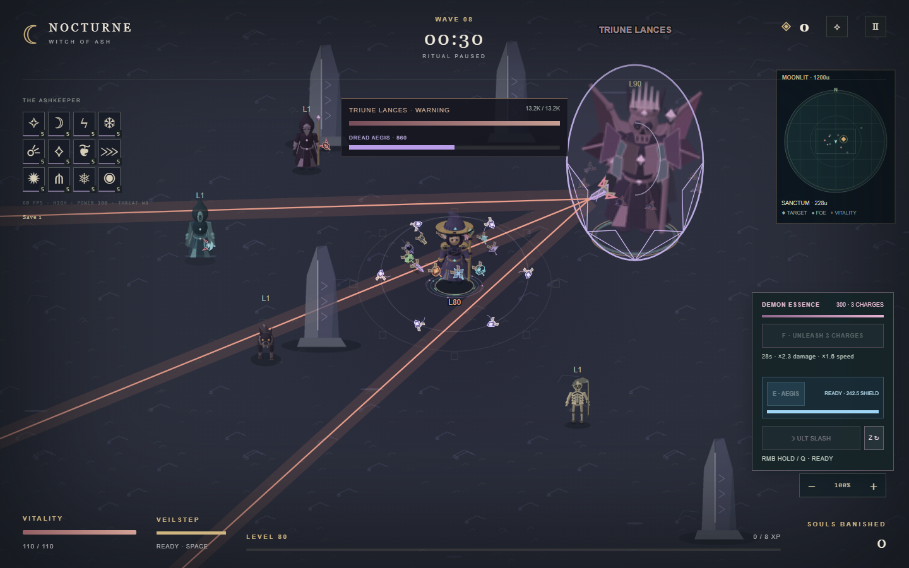
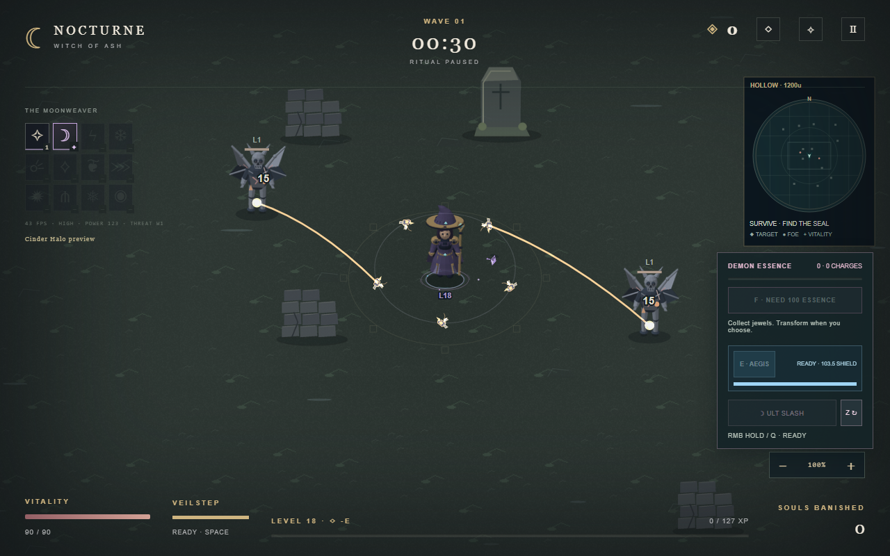
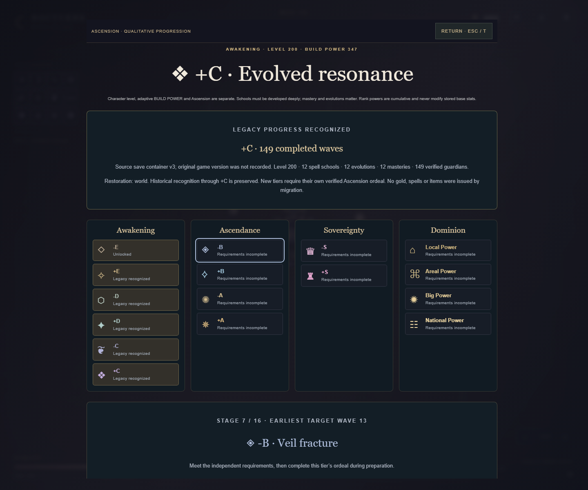
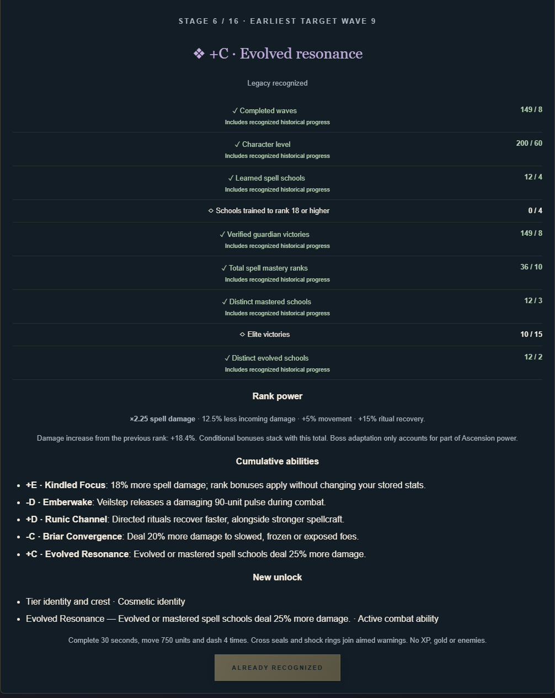
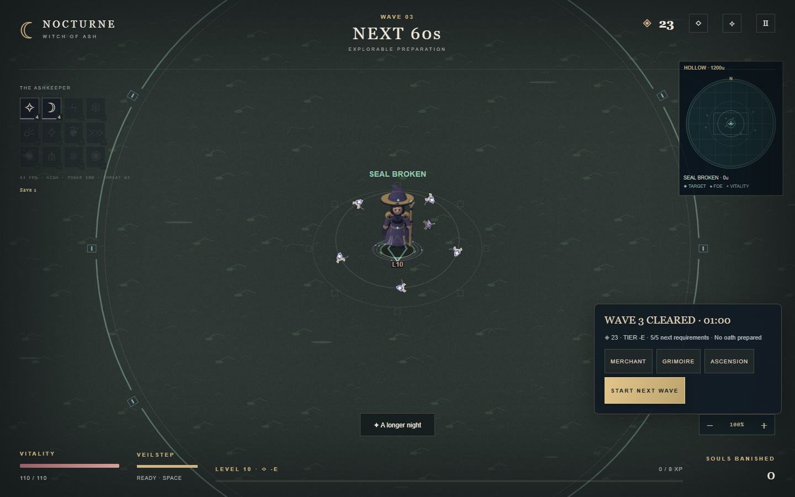
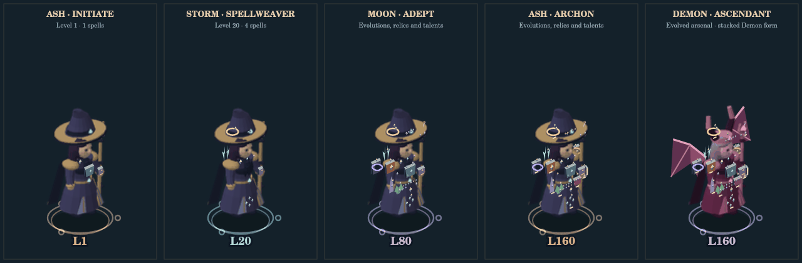
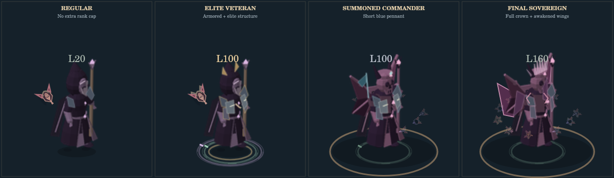
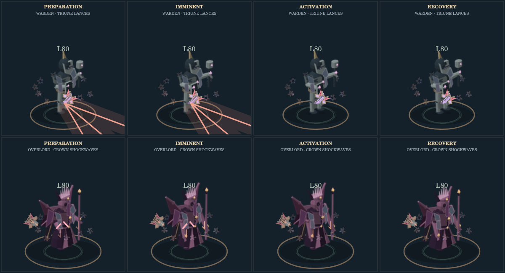
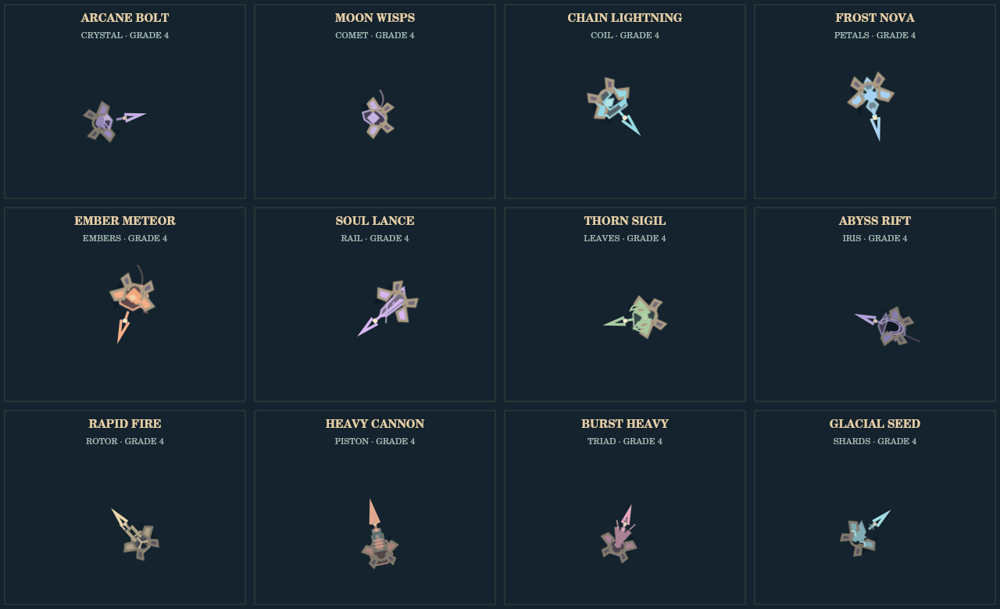

# Nocturne — Witch of Ash: JSCanvasEdition

**<!-- version -->v0.8.2<!-- /version --> · Steady Preparation & Cinder Halo · Initial development**

The HTML5 Canvas and JavaScript edition of [Nocturne — Witch of Ash](../README.md). Survive the Hollow, build a spell arsenal, gather loot and defeat each wave's Final Sovereign.

[Download ZIP](https://github.com/Cavanshirpro/Nocturne/releases/latest) · [Play](#play) · [Controls](#controls) · [Release notes](RELEASES.md) · [Versioning](../VERSIONING.md)



*Existing combat demonstration from v0.7.x; its artwork and combat rules are retained.*

## Visual examples

### Cinder Halo — v0.8.2



Rank-IV Moon Wisps plus Cinder Seed unlock automatic ember volleys at 368 world units. The evolution retains contact ignition and adds three-second ranged ignition, focusing on one foe or distributing its embers over several. [Patch behavior and verification](docs/PATCH_v082.md)

### Ascension power and preparation — v0.8.1



All 16 ranks have cumulative combat power. Promote through deep school training, total mastery, evolutions and 15 playable ordeals. Earn dash pulses, control, ritual and Aegis abilities. Historical recognition through +C is preserved.





The world remains explorable after the required guardian falls. Menus pause preparation; merchant visits retain stock and purchases; early and automatic starts share one guarded transition.

### Witch and Demon progression



*Actual rendered player progression and Demon form.* [Still image](previews/player-regalia.webp)

### Enemy roles



Nine families have solid, eight-direction artwork and individual motion. Traits, veteran regalia and command roles remain readable as your build grows.

### Boss attack stages



Eleven boss powers synchronize body gestures and warning stages with their real attack clocks. The crowned guardian is distinct from its summoned commanders.

### Spell mechanisms and field warnings



Twelve school-specific satellite mechanisms, bounded visual grades, allied field motifs and exact hostile warning boundaries. [Still image](previews/mechanisms-v525.webp)

Open **[visual-gallery.html](visual-gallery.html)** locally for the complete animated gallery, enemy states, boss rituals and historical comparisons. It includes pause and reduced-motion support. Some comparison images retain old development labels; [VERSIONING.md](../VERSIONING.md#historical-numbering-migration) maps them to the current scheme.

## Current release

**<!-- version -->v0.8.2<!-- /version --> — Steady Preparation & Cinder Halo** fixes persistent camera shake after guardian victory and gives evolved Moon Wisps a real midrange attack. The optional ranged cooldown saves exactly; earned ranks, existing saves, lossless WebP artwork and AGPLv3-or-later licensing are preserved.

Start with [architecture](docs/ARCHITECTURE.md), [Ascension](docs/ASCENSION.md), [migration](docs/MIGRATION.md), [assets](docs/ASSETS.md), [wave cycle](docs/WAVE_CYCLE.md) and the [executed technical report](docs/IMPLEMENTATION_REPORT.md). [RELEASES.md](RELEASES.md) contains the history. Earlier renderer design/measurement documents remain historical references.

The game runs locally in a modern browser. No game engine, account, build step, npm package or internet connection is required for play. All WebP images are included; sound uses Web Audio. Keep `assets/` and `src/` alongside `index.html`.

## Play

Download the JSCanvasEdition release archive and extract it, or clone the repository:

```bash
git clone https://github.com/Cavanshirpro/Nocturne.git
cd Nocturne/JSCanvasEdition
```

Open **`index.html`**. Keep the complete `assets/` and `src/` directories together with the entry point and notices.

If your browser restricts local files, optionally serve this folder:

```bash
python -m http.server 8000
```

Then open **http://localhost:8000/**. Python is needed only for this optional server and the asset-development tools.

## Controls

| Input | Action |
| --- | --- |
| `W A S D` / arrow keys | Move; diagonal movement is normalized |
| Automatic targeting | Learned spells attack eligible nearby targets |
| `Space` / `Shift` | Veilstep dash |
| Hold right mouse, then release | Aim and charge the selected special ritual |
| `Q` | Cast the selected special immediately |
| `Z` | Cycle unlocked specials; cooldown is shared |
| **`F` / UNLEASH button** | Activate Demon Witch using banked essence |
| **`E` / AEGIS button** | Raise the temporary player shield |
| Mouse wheel / `+` / `−` | Adjust camera zoom |
| `0` | Reset zoom |
| `I` | Open the grimoire |
| `T` / ◇ HUD button | Inspect Ascension and historical recognition |
| `Esc` / `P` | Pause or resume |
| `1` / `2` / `3` | Choose a level-up gift |
| Touch controls | Move, dash, charge specials, raise Aegis, and activate Demon Witch |

Sound starts after an interaction. Volume, tonal ambience, low-quality rendering, and reduced motion are available in the pause menu. Tonal ambience defaults to off.

## The wave loop

1. Survive the timed swarm and collect XP, gold, healing, and rare Demon Jewels.
2. Choose one of three gifts when leveling up; the world pauses while choosing.
3. At the end of the timer, follow the **crimson diamond** on the minimap or the world-direction arrow to the **Final Sanctum**. Ordinary swarm spawning stops during this final hunt; surviving enemies and hazards remain dangerous.
4. Enter the marked arena to summon its guardian. Every final encounter summons a **Final Sovereign**, a crowned form of Overlord. It stays within its arena and must be defeated before the merchant opens. A surviving invasion boss ascends into the Sovereign and fully heals once; it keeps its identity and never duplicates.
5. Explore during preparation: 60 seconds after waves 1–10, 75 after 11–40, 90 after 41–100 and 105 thereafter. Buy upgrades, lock offers, inspect Ascension and prepare an oath. Blocking menus pause the countdown. Start early or let the next wave begin automatically.

Overlords can invade from wave 3, or wave 2 for builds with pressure at least 1.7. The saved per-wave chance is `clamp(0.08 + 0.015 × max(0, wave − 3) + 0.19 × pressure, 0.08, 0.90)`. High-pressure builds can invade on consecutive waves; lower-pressure builds retain a three-wave gap. Only one primary invasion can occur per wave. Reopening or retrying does not reroll it. Invasions also receive a whole-build vitality budget. Ending the survival timer alone never completes a wave.

## Build-aware wave pressure

The HUD and merchant show **BUILD POWER**. The actual **WAVE** number still counts completed waves; **THREAT W** is the effective wave used for spawn pacing. At maximum build pressure, spawn frequency is multiplied by up to **1.77**, the threat wave increases by up to five, and the living ordinary-enemy budget remains capped at **200**. These limits prevent runaway swarms while preserving the benefit of upgrades.

The survival timer starts at 30 seconds and grows with progression to 60 seconds; extra build pressure can add up to seven seconds. Duration and the invasion roll are fixed at wave start. Every six simulation seconds, ordinary encounter pressure can adjust by at most 0.25 toward your current build. Existing enemies never gain health from this refresh. The final boss assesses your current build separately when its encounter begins.

Gold, missing health, stored essence, active Demon bonuses and Aegis charge do not increase permanent build pressure. Banking and timing temporary abilities remain useful. See [BALANCE.md](BALANCE.md) for the calibration method and its limits.

## Final Sovereign and Aegis

The final boss locks its level, health and damage budgets when the encounter starts, including when an invasion ascends. Level uses the whole-build effective enemy level. Vitality targets roughly **32–47 seconds of estimated sustained damage**, with a small 300-health floor; this is a tuning budget, not a guaranteed real fight duration. Spell coverage, projectile spread, crits, mastery and evolutions contribute. There is no old threefold health ceiling or fivefold vitality floor. Later player upgrades never refill or continually rescale an active boss.

The reference attack stat remains at least five times a same-level Overlord's value, and also grows with player vitality and armor. Actual attacks have separate ceilings based on the player's effective health at encounter start. Armor applies normally. Tier 1+ also has a bounded effective-health minimum per attack so extreme armor cannot make high-tier boss attacks harmless; the separate upper ceilings still apply. A weak character cannot be killed by one full-health contact hit. Several hits, overlapping hazards and minions still require movement and Aegis.

| Guardian power | Counterplay |
| --- | --- |
| **Hellfire Salvo** | A 0.9s locked-aim warning, then 10–18 shots (14–22 enraged). Sidestep, dash or shield. Each shot is capped at 22% of effective health before armor. |
| **Ash Meteors** | Three fixed circles (four enraged) warn for 1.15s. Leave the marked ground; impacts are capped at 30% of effective health before armor. |
| **Soul Reaping** | A warned 245-unit arc. Leave the arc or raise Aegis; capped at 38% of effective health before armor. |
| **Dread Aegis** | A finite ward holds 8–18% of maximum boss vitality for 3–4.6s, depending on combat tier. Tier 1+ can also raise it against a concentrated burst, with 9s recovery. It absorbs damage and never heals. |
| **Soul Constellation** | Radial shots leave a gap along the warned aim. More orbs at higher tiers and when enraged; each is capped at 14% of effective health before armor. |
| **Rift Step** | An arena-bounded destination warns for 1.1s before impact/teleport. Leave its circle; impact is capped at 28% of effective health before armor. |
| **Triune Lances** | Three fixed long rays warn for 1.15s. Move between them or use Aegis; each hit is capped at 32% of effective health before armor. Range accounts for the player's projectile range. |
| **Hunter Starfall** | Tier 2+: a trail of fixed impacts is marked ahead of the player's movement. Change direction after the warning. |
| **Twin Gates** | Tier 2+: two portals appear beside the locked target position, then release crossfire fans. Move out of the crossing lanes. |
| **Crown Shockwaves** | Tier 2+: three staggered annuli leave a safe core and a marked directional gap. Move through the gap rather than crossing a bright band. |
| **Void Seal** | Tier 2+: a purple circle warns for 1.3s. An impact seals new auto-casts, wisps and directed specials for 1.25s. Movement, dash, Aegis, existing projectiles and ground spells remain available. A 7s grace timer from application prevents repeated lockouts. Separate impact circles warn before the follow-up. |

Combat tier runs from 0 to 4 and derives from build power/effective enemy level. Strong tiers shorten recovery, add shots and independently place occasional 1.25s ground warnings. The opening rotation shows the unlocked powers; later choices respond to range and proximity. Boss sidesteps scan nearby projectiles, display a 0.22s direction tell, and move for 0.24s with a 2.9–4.85s recovery. Bosses remain damageable and hold still during their main attack warnings.

Sanctums grow with combat tier and player range, up to a 1,700-unit radius. The guardian remains leashed inside; a player more than 65 units beyond the boundary activates its **Outer Seal** (90% damage reduction). Position-targeted attacks still reach distant players. Returning removes that reduction, with no healing or progress reset.

Tier 3+ guardians can summon **Overlord commanders**. Whole-build soldier vitality grows with damage output; their levels follow effective encounter strength. All reinforcements have at least 1.15s spawn warnings. At most **two summoned Overlords** and **18 summoned creatures** can be alive globally. Commanders only summon soldiers; soldiers cannot summon. Defeating a commander never completes the wave. Below **40% guardian health**, attacks accelerate further. Contact damage remains capped at 42% of effective health before armor.

**Your Aegis** is available from the start for all three covens. It lasts **2.5 seconds**, absorbs `0.75 × maximum vitality + 2 × character level` damage after armor, and has **8 seconds of recovery from activation**. Overflow reaches your Stone oath shield, then vitality. It costs no gold or Demon Essence. A depleted or expired barrier disappears; loading and pausing never refill it. Use movement and dash while it recovers.

## Death and retry

Death **does not delete or replace the active save slot**. It immediately stores a fresh retry for the same wave:

- Retain `floor(current gold / 2)`; lose the remainder. **101 gold → 50 retained, 51 lost.** The loss happens once per death, not again when pressing Retry or loading.
- Keep levels, collected XP, pending level-up gifts, spells, ranks, talents, relics, upgrades, unspent essence, records, and locked merchant offers.
- Restart the current wave at time zero and the starting position, with full vitality. Enemies, boss progress, hazards and uncollected loot reset. Active Demon form ends; spent essence is not refunded.
- Special/Aegis/dash recovery resets for the new attempt. The current wave oath remains in effect; a prepared next-wave oath is not consumed.

Choose **RESTART WAVE** on the death screen or **CONTINUE** from the title after reopening the game. No new save slot is created by retrying. The chronicle counts fallen attempts. If browser storage is unavailable, the death screen says so; retry still works within the current session.

## Demon Essence

Essence has no gameplay storage ceiling. **100 essence = one charge**. Activation spends all complete charges and preserves the remainder. For example, activating with **425 essence** spends 400 and leaves 25 banked.

| Charges spent | Duration | Damage multiplier | Movement multiplier |
| --- | --- | --- | --- |
| 1 | 12 seconds | ×1.8 | ×1.45 |
| 2 | 20 seconds | ×2.1 | ×1.55 |
| 4 | 36 seconds | ×2.4 | ×1.65 |

For `c` complete charges, duration is `12 + 8 × (c − 1)` seconds, damage is `1.8 + 0.3 × log₂(c)`, and speed is `1.45 + 0.1 × log₂(c)`. The HUD previews the result before activation.

Jewels grant their full essence value during a transformation and bank it for a later activation. An active form cannot be restarted, and expiration never spends the bank automatically. Nearby ordinary enemies flee in fear; bosses resist it. The minimum activation cost and finite rendering pools are intentional; player progression has no added gameplay rank ceiling.

## Existing gameplay

- **Three covens:** Ashkeeper, Moonweaver, and Stormcaller have distinct starting stats and spells.
- **Twelve automatic spells:** Arcane Bolt, Moon Wisps, Chain Lightning, Frost Nova, Ember Meteor, Soul Lance, Thorn Sigil, Abyss Rift, Rapid Fire, Heavy Cannon, Burst Heavy, and Glacial Seed; each has an evolution path.
- **Directed specials:** Ult Slash, Winter Dominion, and Soulstorm unlock through character levels.
- **Endless progression:** spell ranks, mastery, talents, and repeatable merchant upgrades.
- **Mixed enemy levels:** the unpressured level-40+ mix is 80% weaker / 15% peer / 5% veteran. Gear pressure shifts some encounters toward stronger bands; most remain weaker, and mature fodder stays below the actual character level. Bosses use separate budgets.
- **Animated combat:** eight-direction witch animation, nine enemy families, attack tells, fear poses, projectile trails, impact effects, and synthesized sounds.

## Saves and upgrades

There are **24 independent local save slots**, with renaming and additive JSON backup import/export. This release uses the separate `nocturne.coven.v4` key and container schema 4. It copies supported v3/v2 storage without deleting the original keys, validates each chapter independently and recognizes historical progress conservatively. New checkpoint schema 3 adds explicit preparation state and exact pending gift choices; existing world snapshot rules remain supported.

Export a backup from **SAVES** before upgrading. Replace the complete edition, then use the same browser, profile and game address. A different folder, localhost port, website or browser may have a different origin; move with backup export/import. Storage failures are reported, original data is retained and recovery data remains exportable. See [MIGRATION.md](docs/MIGRATION.md) for evidence rules, schema details and limitations.

## Source layout

| Path | Responsibility |
| --- | --- |
| `src/core/`, `src/bootstrap.js` | Namespace, input, spatial index, loader, single fixed-step game loop and startup |
| `src/data/` | Configuration and all 16 centralized tier descriptors |
| `src/entities/`, `src/combat/` | Existing actor, spell and collision behavior |
| `src/systems/` | Progression, difficulty, guardian/warfare, Ascension, trials, wave cycle, migration and storage |
| `src/rendering/` | Original art, animation, cloth, orbitals, fields and world presentation |
| `src/ui/`, `src/styles/` | Existing menus/HUD plus Ascension and preparation views |
| `assets/` | Lightweight manifest, separate metadata and 64 lossless WebP files |
| `tools/` | Reproducible Python generators, native galleries, browser tests, benchmarks and probes |
| `tests/` | Existing regression groups, new focused tests and synthetic legacy fixtures |
| `docs/`, `previews/`, `visual-gallery.html` | Current guides, technical report and actual renderer examples |

## Development checks

From this edition:

```bash
node tests/run.mjs
python -m unittest discover -s tests -p test_assets.py
node tools/balance-probe.mjs
node tools/progression_probe.mjs
```

Node.js 18+ runs the logic checks without npm dependencies. Python with Pillow runs asset checks/generation. The Pillow suite regenerates into a temporary directory. Optional browser/native tools require their stated development-only packages:

```bash
# Serve the edition, then open browser-tests.html and RUN BROWSER CHECKS.
python -m http.server 8000
# Or use Playwright and your local Chromium:
node tools/verify_foundations.cjs
```

See [ASSETS.md](docs/ASSETS.md) for generation and [IMPLEMENTATION_REPORT.md](docs/IMPLEMENTATION_REPORT.md) for actual results and platform limitations. Automated sound checks do not certify physical speakers or real-device performance.

## Issues

Report issues at [Cavanshirpro/Nocturne](https://github.com/Cavanshirpro/Nocturne/issues), including **JSCanvasEdition**, version/commit, browser and operating system, reproduction steps, and expected behavior. Avoid posting private backups or personal data.

## License and credits

This edition is licensed under the **GNU Affero General Public License, version 3 or (at your option) any later version** (`AGPL-3.0-or-later`). [LICENSE](LICENSE) contains the unmodified license text; [NOTICE](NOTICE) contains the project copyright, license grant and warranty disclaimer. Preserve the required copyright, license and attribution notices when redistributing, mark your modifications and provide corresponding source as required by the license.

The title screen links to this version's source and copyright/warranty notice. If you host a modified version with remote network interaction, prominently offer its users the corresponding source of your version at no charge under section 13. Update the source link to your own modified source, rather than leaving it pointed only at upstream.

- **Creator and developer:** Cavanshir Qurbanzade (YoungLion)
- **Prompter (JSCanvasEdition):** [@oustxr](https://github.com/oustxr)

Copyright (C) 2026 Javanshir Gurbanzade. Distributed without warranty; see [NOTICE](NOTICE).
