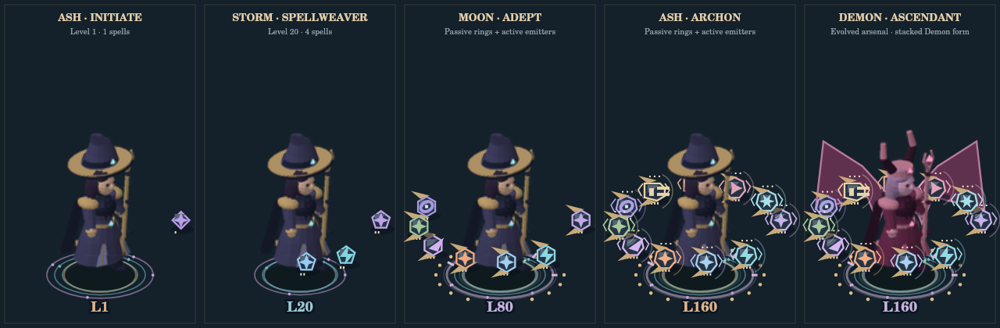

# Nocturne — Witch of Ash: JSCanvasEdition

**Version 5.2.3 · Orbit & Flow**

**JSCanvasEdition** is the HTML5 Canvas and JavaScript implementation of [Nocturne — Witch of Ash](https://github.com/Cavanshirpro/Nocturne), a dark-fantasy, top-down arena survival game. Move through the Hollow, build a spell arsenal, gather loot, and defeat each wave's final guardian.

The game runs locally in a modern browser. No game engine, account, build step, npm package, or internet connection is required for play. Images are embedded in `assets.js`; sound effects are synthesized through Web Audio.

## What's new in 5.2.3

- **Passive circles, active satellites:** defence, movement and focus upgrades appear in restrained rings. Automatic spells have distinct orbiting emitter hulls instead of costume badges. Enemy armour/mending/swiftness and ranged/boss skills use the same system.
- **Real emission points:** primary bolts, Rapid Fire, Heavy Cannon, Burst and Glacial Seed start at their visible satellite. Lightning and beams originate there; targeted fields have delivery trails. Twin Gates retain their warned remote portal origins.
- **Clear body animation:** automatic fire leaves idle/walk animation alone. Deliberate directed rituals, Aegis, transformation, hurt and dash retain body poses. Ordinary ranged enemies and sustained guardian salvos follow the same separation.
- **Motion and cloth:** longer strides, stronger hand gestures and speed-reactive lower-sprite bands suggest fabric movement without a live mesh, physics solver or WebGL. Two bands on low quality/dense ordinary crowds, at most six otherwise; reduced motion uses one static atlas draw.
- **Readable growth:** hull facets, brighter tones and inset grade marks grow in five bounded grades. Gold fins mark evolution; small top insets mark mastery. Passive ring colour and thickness reflect their current grades. Exact ranks remain in the grimoire.
- **Complete offline source:** regenerated directional sprites, an animated shared-system demonstration and a five-grade comparison are included.

See [ORBITALS.md](ORBITALS.md) for the exact mapping and implementation boundaries. Open [visual-gallery.html](visual-gallery.html) for the actual renderings.

## Previous changes in 5.2.2


- **Solid sculpted characters:** the Witch and Demon are rebuilt from shaded, depth-sorted meshes baked into all eight directional sprite atlases. Rounded shoulders, thick sleeves, faces, boots, fitted coats and a solid hat brim replace the earlier flat panels.
- **Fitted equipment:** twelve different solid spell fixtures, a chest cuirass, focus bracer, boot fittings and compact inset ornaments preserve progression without stacking long floating outlines. All thirteen permanent training categories have visible effects.
- **Tactical compass minimap:** fixed local scale, player heading, north, separate boss/elite markers, valuable pickups, sanctum boundaries and a distance label. Distant targets stay visible at the edge. Dense swarms share map cells to limit marker drawing. Responsive placement avoids the boss and power panels.
- **Right-click modal fix:** the browser context menu is suppressed even if a level-up menu appears while charging. Editable text fields retain their clipboard menus.
- **Complete offline package:** regenerated artwork, animated eight-direction gallery, map examples and all source files are included. Runtime version and versioned script URLs identify this build as 5.2.2.

Open [visual-gallery.html](visual-gallery.html) for the new player, direction and minimap galleries.

## Previous visual work (5.2.1)


- Deeper robe, skull, hat and boot geometry keeps side views solid in all eight directions. This is lightweight 2.5D artwork rendered with Canvas, not a real-time 3D engine.
- Permanent upgrades form three readable equipment groups: offensive focus, defensive cuirass and mobility fittings. All twelve spell attachments, mastery, evolutions, talents and relics remain represented.
- Atlas-frame blending smooths motion at normal/high quality. Low quality and reduced motion keep a single sprite draw.
- All embedded atlases and player previews are included and regenerated. Open `index.html` to play; no patch installer or asset generation is needed.

## Features inherited from 5.2.0

- **Living Regalia:** learned spells become visible staff, bracer, shoulder, belt and mantle equipment. All twelve spell pieces coexist; mastery, evolutions, relics, talents, directed rituals, oath and permanent upgrades refine the costume.
- **Rebuilt player model:** layered brocade, jointed arms, fingers, individual boots, moving hair, a face plane, a sculpted hat and a forked staff. Coven palettes and five level milestones change the regalia.
- **Demon Ascendant:** a separate eight-direction model with 192 frames, plus articulated wings, antlers and armor that grow with stacked form power. Your learned equipment stays visible.
- **Nine renewed enemy families:** engraved armor, masks, manes, spectral ribbons, wing facets, skull cores and articulated weapons. Level, traits, elite status and commander identity appear on their bodies.
- **Eleven distinct boss casting rigs:** 1,056 directional power frames, supported by attack-specific body effects. No generic casting pose shared by all eleven attacks.
- **Readable magic:** different projectile shapes, charge-sensitive ward facets and a large, read-only current-costume portrait in the grimoire. High-haste casting remains visibly animated.
- **Visual release:** v5.1.3 damage, AI, difficulty, summons, timers, hitboxes, controls, progression and save rules are retained.



Open **[visual-gallery.html](visual-gallery.html)** for animated player/enemy/boss comparisons. See **[VISUALS.md](VISUALS.md)** for the complete equipment mapping and art notes.

See [RELEASES.md](RELEASES.md) for version-specific changes and migration notes.

## Play

Download the JSCanvasEdition release archive and extract it, or clone the repository:

```bash
git clone https://github.com/Cavanshirpro/Nocturne.git
cd Nocturne/JSCanvasEdition
```

Open **`index.html`**. Keep all files and the `systems` directory together.

If your browser restricts local files, optionally serve this folder:

```bash
python -m http.server 8000
```

Then open **http://localhost:8000/**. Python is needed only for this optional server and the asset-development tools.

## Controls

| Input | Action |
| --- | --- |
| `W A S D` / arrow keys | Move; diagonal movement is normalized |
| Automatic targeting | Learned spells attack eligible nearby targets |
| `Space` / `Shift` | Veilstep dash |
| Hold right mouse, then release | Aim and charge the selected special ritual |
| `Q` | Cast the selected special immediately |
| `Z` | Cycle unlocked specials; cooldown is shared |
| **`F` / UNLEASH button** | Activate Demon Witch using banked essence |
| **`E` / AEGIS button** | Raise the temporary player shield |
| Mouse wheel / `+` / `−` | Adjust camera zoom |
| `0` | Reset zoom |
| `I` | Open the grimoire |
| `Esc` / `P` | Pause or resume |
| `1` / `2` / `3` | Choose a level-up gift |
| Touch controls | Move, dash, charge specials, raise Aegis, and activate Demon Witch |

Sound starts after an interaction. Volume, tonal ambience, low-quality rendering, and reduced motion are available in the pause menu. Tonal ambience defaults to off.

## The wave loop

1. Survive the timed swarm and collect XP, gold, healing, and rare Demon Jewels.
2. Choose one of three gifts when leveling up; the world pauses while choosing.
3. At the end of the timer, follow the **crimson diamond** on the minimap or the world-direction arrow to the **Final Sanctum**. Ordinary swarm spawning stops during this final hunt; surviving enemies and hazards remain dangerous.
4. Enter the marked arena to summon its guardian. Every final encounter summons a **Final Sovereign**, a crowned form of Overlord. It stays within its arena and must be defeated before the merchant opens. A surviving invasion boss ascends into the Sovereign and fully heals once; it keeps its identity and never duplicates.
5. Buy upgrades, reroll or refill stock, lock offers, prepare an oath, then start the next wave.

Overlords can invade from wave 3, or wave 2 for builds with pressure at least 1.7. The saved per-wave chance is `clamp(0.08 + 0.015 × max(0, wave − 3) + 0.19 × pressure, 0.08, 0.90)`. High-pressure builds can invade on consecutive waves; lower-pressure builds retain a three-wave gap. Only one primary invasion can occur per wave. Reopening or retrying does not reroll it. Invasions also receive a whole-build vitality budget. Ending the survival timer alone never completes a wave.

## Build-aware wave pressure

The HUD and merchant show **BUILD POWER**. The actual **WAVE** number still counts completed waves; **THREAT W** is the effective wave used for spawn pacing. At maximum build pressure, spawn frequency is multiplied by up to **1.77**, the threat wave increases by up to five, and the living ordinary-enemy budget remains capped at **200**. These limits prevent runaway swarms while preserving the benefit of upgrades.

The survival timer starts at 30 seconds and grows with progression to 60 seconds; extra build pressure can add up to seven seconds. Duration and the invasion roll are fixed at wave start. Every six simulation seconds, ordinary encounter pressure can adjust by at most 0.25 toward your current build. Existing enemies never gain health from this refresh. The final boss assesses your current build separately when its encounter begins.

Gold, missing health, stored essence, active Demon bonuses and Aegis charge do not increase permanent build pressure. Banking and timing temporary abilities remain useful. See [BALANCE.md](BALANCE.md) for the calibration method and its limits.

## Final Sovereign and Aegis

The final boss locks its level, health and damage budgets when the encounter starts, including when an invasion ascends. Level uses the whole-build effective enemy level. Vitality targets roughly **32–47 seconds of estimated sustained damage**, with a small 300-health floor; this is a tuning budget, not a guaranteed real fight duration. Spell coverage, projectile spread, crits, mastery and evolutions contribute. There is no old threefold health ceiling or fivefold vitality floor. Later player upgrades never refill or continually rescale an active boss.

The reference attack stat remains at least five times a same-level Overlord's value, and also grows with player vitality and armor. Actual attacks have separate ceilings based on the player's effective health at encounter start. Armor applies normally. Tier 1+ also has a bounded effective-health minimum per attack so extreme armor cannot make high-tier boss attacks harmless; the separate upper ceilings still apply. A weak character cannot be killed by one full-health contact hit. Several hits, overlapping hazards and minions still require movement and Aegis.

| Guardian power | Counterplay |
| --- | --- |
| **Hellfire Salvo** | A 0.9s locked-aim warning, then 10–18 shots (14–22 enraged). Sidestep, dash or shield. Each shot is capped at 22% of effective health before armor. |
| **Ash Meteors** | Three fixed circles (four enraged) warn for 1.15s. Leave the marked ground; impacts are capped at 30% of effective health before armor. |
| **Soul Reaping** | A warned 245-unit arc. Leave the arc or raise Aegis; capped at 38% of effective health before armor. |
| **Dread Aegis** | A finite ward holds 8–18% of maximum boss vitality for 3–4.6s, depending on combat tier. Tier 1+ can also raise it against a concentrated burst, with 9s recovery. It absorbs damage and never heals. |
| **Soul Constellation** | Radial shots leave a gap along the warned aim. More orbs at higher tiers and when enraged; each is capped at 14% of effective health before armor. |
| **Rift Step** | An arena-bounded destination warns for 1.1s before impact/teleport. Leave its circle; impact is capped at 28% of effective health before armor. |
| **Triune Lances** | Three fixed long rays warn for 1.15s. Move between them or use Aegis; each hit is capped at 32% of effective health before armor. Range accounts for the player's projectile range. |
| **Hunter Starfall** | Tier 2+: a trail of fixed impacts is marked ahead of the player's movement. Change direction after the warning. |
| **Twin Gates** | Tier 2+: two portals appear beside the locked target position, then release crossfire fans. Move out of the crossing lanes. |
| **Crown Shockwaves** | Tier 2+: three staggered annuli leave a safe core and a marked directional gap. Move through the gap rather than crossing a bright band. |
| **Void Seal** | Tier 2+: a purple circle warns for 1.3s. An impact seals new auto-casts, wisps and directed specials for 1.25s. Movement, dash, Aegis, existing projectiles and ground spells remain available. A 7s grace timer from application prevents repeated lockouts. Separate impact circles warn before the follow-up. |

Combat tier runs from 0 to 4 and derives from build power/effective enemy level. Strong tiers shorten recovery, add shots and independently place occasional 1.25s ground warnings. The opening rotation shows the unlocked powers; later choices respond to range and proximity. Boss sidesteps scan nearby projectiles, display a 0.22s direction tell, and move for 0.24s with a 2.9–4.85s recovery. Bosses remain damageable and hold still during their main attack warnings.

Sanctums grow with combat tier and player range, up to a 1,700-unit radius. The guardian remains leashed inside; a player more than 65 units beyond the boundary activates its **Outer Seal** (90% damage reduction). Position-targeted attacks still reach distant players. Returning removes that reduction, with no healing or progress reset.

Tier 3+ guardians can summon **Overlord commanders**. Whole-build soldier vitality grows with damage output; their levels follow effective encounter strength. All reinforcements have at least 1.15s spawn warnings. At most **two summoned Overlords** and **18 summoned creatures** can be alive globally. Commanders only summon soldiers; soldiers cannot summon. Defeating a commander never completes the wave. Below **40% guardian health**, attacks accelerate further. Contact damage remains capped at 42% of effective health before armor.

**Your Aegis** is available from the start for all three covens. It lasts **2.5 seconds**, absorbs `0.75 × maximum vitality + 2 × character level` damage after armor, and has **8 seconds of recovery from activation**. Overflow reaches your Stone oath shield, then vitality. It costs no gold or Demon Essence. A depleted or expired barrier disappears; loading and pausing never refill it. Use movement and dash while it recovers.

## Death and retry

Death **does not delete or replace the active save slot**. It immediately stores a fresh retry for the same wave:

- Retain `floor(current gold / 2)`; lose the remainder. **101 gold → 50 retained, 51 lost.** The loss happens once per death, not again when pressing Retry or loading.
- Keep levels, collected XP, pending level-up gifts, spells, ranks, talents, relics, upgrades, unspent essence, records, and locked merchant offers.
- Restart the current wave at time zero and the starting position, with full vitality. Enemies, boss progress, hazards and uncollected loot reset. Active Demon form ends; spent essence is not refunded.
- Special/Aegis/dash recovery resets for the new attempt. The current wave oath remains in effect; a prepared next-wave oath is not consumed.

Choose **RESTART WAVE** on the death screen or **CONTINUE** from the title after reopening the game. No new save slot is created by retrying. The chronicle counts fallen attempts. If browser storage is unavailable, the death screen says so; retry still works within the current session.

## Demon Essence

Essence has no gameplay storage ceiling. **100 essence = one charge**. Activation spends all complete charges and preserves the remainder. For example, activating with **425 essence** spends 400 and leaves 25 banked.

| Charges spent | Duration | Damage multiplier | Movement multiplier |
| --- | --- | --- | --- |
| 1 | 12 seconds | ×1.8 | ×1.45 |
| 2 | 20 seconds | ×2.1 | ×1.55 |
| 4 | 36 seconds | ×2.4 | ×1.65 |

For `c` complete charges, duration is `12 + 8 × (c − 1)` seconds, damage is `1.8 + 0.3 × log₂(c)`, and speed is `1.45 + 0.1 × log₂(c)`. The HUD previews the result before activation.

Jewels grant their full essence value during a transformation and bank it for a later activation. An active form cannot be restarted, and expiration never spends the bank automatically. Nearby ordinary enemies flee in fear; bosses resist it. The minimum activation cost and finite rendering pools are intentional; player progression has no added gameplay rank ceiling.

## Existing gameplay

- **Three covens:** Ashkeeper, Moonweaver, and Stormcaller have distinct starting stats and spells.
- **Twelve automatic spells:** Arcane Bolt, Moon Wisps, Chain Lightning, Frost Nova, Ember Meteor, Soul Lance, Thorn Sigil, Abyss Rift, Rapid Fire, Heavy Cannon, Burst Heavy, and Glacial Seed; each has an evolution path.
- **Directed specials:** Ult Slash, Winter Dominion, and Soulstorm unlock through character levels.
- **Endless progression:** spell ranks, mastery, talents, and repeatable merchant upgrades.
- **Mixed enemy levels:** the unpressured level-40+ mix is 80% weaker / 15% peer / 5% veteran. Gear pressure shifts some encounters toward stronger bands; most remain weaker, and mature fodder stays below the actual character level. Bosses use separate budgets.
- **Animated combat:** eight-direction witch animation, nine enemy families, attack tells, fear poses, projectile trails, impact effects, and synthesized sounds.

## Saves and upgrades

There are **24 independent local save slots**, with renaming and JSON backup export/import. Legacy single-save data migrates into **Save 1**. Imports add chapters without overwriting existing ones.

Export a backup from **SAVES** before upgrading. Replace the edition's files together, then use the same browser, profile, and game address. Clearing site data, private browsing, a different localhost port, or a different browser can make local saves unavailable. Direct-file save behavior depends on the browser.

v5.2.0 accepts the supported v5.1.3/v5.1.2/v5.1.1/v5.1.0/v5.0 saves. Player progression, essence, merchant stock, health, sanctums, attacks and cooldowns remain. A fighting v5.1.2 guardian receives tactics once **without changing its current or maximum vitality**; its ward percentage and attack clocks remain, and the arena expands. Earlier guardians follow their existing vitality migration. Snapshots preserve army ownership/depth, the primary guardian's identity, sidestep clocks, suppression, ring gaps and seal warnings. Appearance is derived from existing state; v5.2.0 needs no cosmetic save migration. Saves made after migration load exactly without repeating it. Older supported v3/v4 data still follows the existing migration path.

## Source layout

| File | Responsibility |
| --- | --- |
| `index.html`, `style.css` | Menus, HUD, controls, and layout |
| `game.js` | Main loop, input, camera, waves, checkpoints |
| `entities.js` | Player, enemies, loot, health changes |
| `combat.js` | Spells, collisions, particles, damage numbers |
| `ui.js` | Level-up choices, shop, saves, grimoire |
| `systems/abilities.js` | Charged specials and banked Demon form |
| `systems/encounters.js` | Final sanctum, guardian leash, minimap |
| `systems/guardian.js` | Sovereign scaling, warned powers, temporary boss ward |
| `systems/appearance.js` | Read-only costume composition, progression regalia and spell equipment |
| `witch_models.py` | Articulated witch and dedicated Demon model |
| `visual-gallery.html`, `previews/`, `VISUALS.md` | Animated art atlas and complete visual mapping |
| `systems/warfare.js` | Combat tiers, arena sizing, armies, silence and predictive sidesteps |
| `systems/difficulty.js` | Whole-build assessment, saved wave plans, encounter budgets |
| `systems/vitality.js` | Player health feedback and red screen edges |
| Other `systems/*.js` | Progression, balance, encounter distribution, animation, audio, snapshots, storage |
| `assets.js` | Embedded PNG assets and atlas metadata |
| `generate_assets.py`, `enemy_models.py` | Reproducible procedural artwork source |
| `tests.mjs`, `test_assets.py`, `browser-tests.html` | Logic, asset, and browser verification |
| `balance-probe.mjs`, `BALANCE.md` | Reproducible throughput fixture and calibration notes |

## Development checks

```bash
node tests.mjs
python -m unittest test_assets.py
node balance-probe.mjs
```

Logic tests need Node.js 18+. Asset checks and generation need Python with Pillow. For real browser checks, serve the folder and open **`browser-tests.html`**, then choose **RUN BROWSER CHECKS**. Browser fixtures use a separate verification save store. This is a manual developer page, not the normal game entry point.

Do not equate automated sound waveform checks with testing physical speaker output or real-device performance.

## Issues

Report issues at [Cavanshirpro/Nocturne](https://github.com/Cavanshirpro/Nocturne/issues), including **JSCanvasEdition**, version/commit, browser and operating system, reproduction steps, and expected behavior. Avoid posting private backups or personal data.

## License and credits

This edition includes the **GNU Affero General Public License, version 3**; see [LICENSE](LICENSE). Preserve the applicable copyright, license, and attribution notices when redistributing.

- **Creator and developer:** Cavanshir Qurbanzade (YoungLion)
- **Prompter (JSCanvasEdition):** [@oustxr](https://github.com/oustxr)

Copyright (C) 2026 Cavanshir Qurbanzade.
