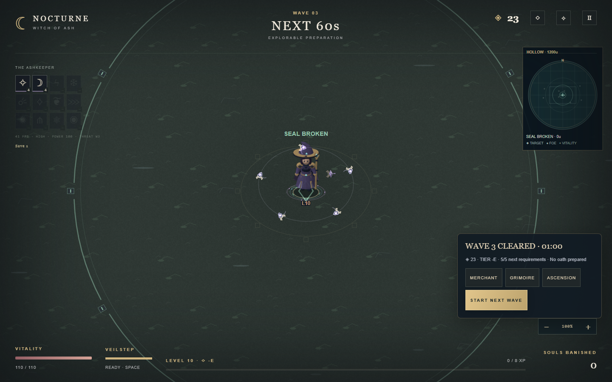
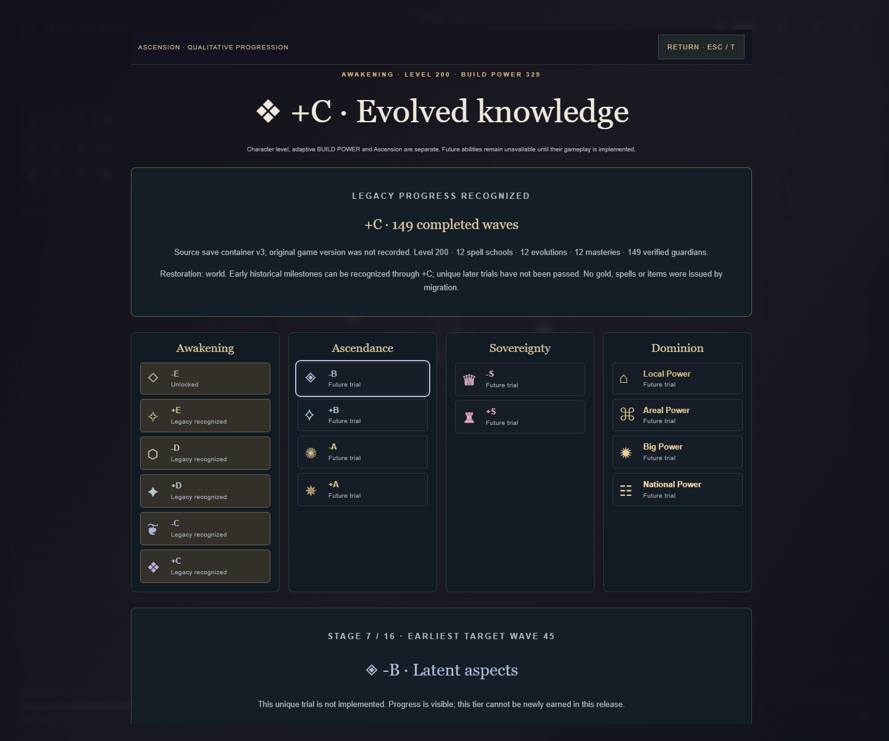

# v0.8.0 — Ascension Foundations: implementation and validation report

Prepared 3 November 2026 against v0.7.7 (`23d7eb973962f76b6e9d264688ce5083754a3896`). The requested v5.3.0 milestone is published as **v0.8.0**, following the project's MAJOR.MINOR.PATCH policy and the owner's explicit version choice. This report describes executed work, synthetic fixtures and measured limitations; it does not claim that future trials or powers are playable.

## 1. Implemented features

- **Ascension:** all 16 ordered stages, four eras, independent requirements, persistent monotonic state, a read-only evaluator, explicit guarded advancement, cosmetic chronicle milestones and a restrained earned crest. Level, BUILD POWER, boss combat tier and Ascension remain separate. **T**, the HUD and Grimoire open the detailed ladder. Future features have explicit unavailable states and accessible text labels.
- **First Ember:** the playable +E introductory trial requires three completed waves and separate character-development evidence, then 20 simulation seconds, 250 movement units and a dash. Existing nonlethal warning geometry tests movement/defence; there are no trial enemies, XP or gold. Failure can be retried. Completion awards once, survives ordinary death and reload, and cannot be manufactured by a premature completion callback. Reload interrupts an unfinished trial without awarding it.
- **Historical recognition:** each supported old chapter is evaluated independently, deterministically and conservatively through +C. Proven achievements receive cosmetic milestone recognition without fabricating completed unique trials. A one-time summary explains the source save format, evidence, restored state and award; it remains reviewable.
- **Preparation:** the required guardian's defeat starts an explorable intermission of 60/75/90/105 simulation seconds after completed waves 1–10/11–40/41–100/101+. No ordinary enemies or loot spawn. Merchant stock persists across visits. Early and automatic next-wave actions share one guard. Blocking menus, pending gifts and inactive simulation freeze the countdown; First Ember suspends it while its own trial runs.
- **Safe checkpoints:** exact preparation time, location, stock, Ascension and current pending gift choices persist. Guardian completion, rewards and pending gifts are checkpointed together. Repeated callbacks, reloads and merchant visits do not duplicate completion rewards, healing, invasion rolls or purchases.
- **Assets and structure:** 64 existing PNGs replace the embedded image bundle. Ordered classic scripts retain the dependency-free Canvas 2D runtime and local-file compatibility. Source, art tools, tests and current documentation now have responsibility-based directories.
- **Release presentation:** version labels, source links, both READMEs, visual gallery, release notes, checks and source packaging use v0.8.0. The README examples below are actual Chromium captures of a preparation fixture and a synthetic migrated character, rather than mockups.





Only First Ember newly advances a fresh character in this release. Advanced unique trials, latent spell aspects, specializations, enhanced Coven identities, summoning and Dominion abilities are registered foundations, **not implemented gameplay**. Their unavailable status is intentional and visible.

## 2. Architecture changes

```text
JSCanvasEdition/
├── index.html, NOTICE.html, LICENSE, NOTICE
├── assets/
│   ├── manifest.js
│   ├── metadata/{atlas,packing,cloth,animations}.js
│   └── images/
│       ├── characters/{witch,demon,enemies}/
│       ├── environments/{grounds,props}/
│       └── effects/
├── src/
│   ├── bootstrap.js
│   ├── core/{game-state,spatial-hash,input,asset-loader,game}.js
│   ├── data/{configuration,tiers}.js
│   ├── entities/entities.js
│   ├── combat/combat.js
│   ├── systems/                 # Progression, migration, storage, trials, wave cycle
│   ├── rendering/               # Existing Canvas systems and Ascension identity
│   ├── ui/{ui,ascension-ui,wave-ui}.js
│   └── styles/{base,ascension}.css
├── tools/                      # Offline art, galleries, probes, browser validation
├── tests/
│   ├── run.mjs, tests.mjs, helpers.mjs, test_assets.py
│   ├── {ascension,migration,wave-cycle,asset-loader}.test.mjs
│   └── fixtures/               # Synthetic legacy JSON and shipped-pixel baseline
├── docs/                       # Current guides and this report
├── previews/                   # Actual renderer examples; earlier galleries retained
└── validation-logs/             # Executed results; older files remain historical
```

`index.html` owns the executable script order. Bootstrap validates and loads images before constructing the game or opening storage. `Game` retains the single simulation loop; `WaveCycle` owns world-phase transitions while `Game.state` owns blocking menus. The tier registry owns descriptors, `Ascension.evaluate` only evaluates, trials produce verified outcomes, and advancement persists them explicitly. Migration converts copies; storage validates and commits per chapter. Render systems retain their established gameplay inputs and do not award progression. See [ARCHITECTURE.md](ARCHITECTURE.md) for ownership and extension boundaries.

## 3. Asset migration

| Metric | v0.7.7 | v0.8.0 |
| --- | ---: | ---: |
| Embedded `assets.js` | 25,708,371 bytes | Removed; neither loaded nor generated |
| Separate PNGs | Embedded in JavaScript | 64 files; 18,810,779 bytes |
| Static image manifest | Part of embedded bundle | 4,770 bytes |
| Separate metadata | Part of embedded bundle | 624,538 bytes in four scripts |
| Active startup images | 55 | 55 |
| Active raw RGBA area | 105,222,144 bytes | 105,222,144 bytes (100.35 MiB) |

All **64 PNG byte streams and decoded RGBA pixels match** the shipped baseline. Atlas dimensions, facings, animation clips, trim offsets, cloth masks, real emitters and eleven ritual atlases remain intact. Nine unused legacy walk strips are retained on disk but are not decoded at startup. The RGBA number measures image area only; it is not total browser RAM or GPU allocation.

The static manifest maps stable logical IDs to local relative PNG paths. Metadata is split into atlas, packing, cloth and animation scripts. The loader checks required keys and path safety, caches per-URL promises, reports completed/total progress and names a missing or undecodable path. Failure occurs before save initialization. Development-only Python/Pillow generation writes PNG bytes, these scripts and existing preview GIFs without base64. Two complete temporary generations test repeatability without overwriting shipped artwork.

HTTP and direct `file://` startup were exercised separately in Chromium. There is no fetch, module server, CDN, new runtime package or external asset service. Other browsers may restrict local-file storage differently. For predictable storage origins, serve the complete edition with `python -m http.server 8000`. Cross-Pillow regeneration can differ; exact shipped-pixel preservation and same-toolchain generation determinism are separate checks. See [ASSETS.md](ASSETS.md).

## 4. Legacy migration

Supported entry containers are schema 3 multi-chapter and schema 2 single-save data. Existing older character/ability migration rules remain in place. The new key is `nocturne.coven.v4`; v3 and v2 source keys are retained. Verification mode uses a separate `.qa.v4` key. The new container is schema 4, checkpoints schema 3, and Ascension/cycle records schema 1. The existing world snapshot remains schema 1. Schema identifiers are independent of release numbers.

Each chapter converts and validates independently. Active-world checkpoints preserve guardian identity, current/max health, attack clocks and enemy ownership. Old merchant snapshots retain stock, locks, prices and purchases and open in preparation with the full configured duration, since no old preparation timer existed. Invalid worlds can recover permanent character progress at the wave start with a warning and retain the full original checkpoint. Unrecoverable chapters, invalid identifiers and excess chapters remain exportable recovery records. Starting a new ritual from a damaged chapter allocates a separate chapter. Undecodable current-container bytes block writes and remain available as recovery data; storage/quota failure does not erase the older key.

Recognition checks completed waves, level, learned schools, normalized developed ranks, run guardian evidence, elite victories and later evolution/mastery separately. Each school's evaluation contribution saturates at 8; the actual unlimited rank does not change. Active/retry wave N proves at most N−1 completed waves; an old merchant proves its just-completed wave. Profile best-wave/boss totals alone do not prove the active ritual's history. Guardian credit also needs saved mandatory-guardian-era evidence. Awards stop at +C and do not populate `completedTrials`.

| Synthetic character | Historical recognition |
| --- | --- |
| New, level 1, current wave 1 | -E |
| Level 6, wave 5, two rank-IV schools and guardian proof | +E |
| Level 24, wave 20, four rank-IV schools and combat evidence | +D; only 19 completed waves, short of -C's 21 |
| Level 60, wave 50, six developed schools and evolution/mastery | +C |
| Level 200, wave 150, twelve evolved/mastered schools | +C; advanced evidence is visible, unique trials remain unverified |
| Level 100,000, wave 1, one rank-1,000,000 spell and extreme damage | -E; stats cannot replace completed progress or breadth |

These are fixtures, not real-player telemetry. Missing historical fields receive conservative credit; they are not invented. Old saves did not record the original game-release version, so the summary identifies the save format instead. Pending gifts take priority over the summary. Qualified old characters receive cosmetic recognized milestones automatically; they do not receive invented gold, XP, abilities, aspects, summons or unique trial completions. First Ember remains the only implemented unique trial; later trials must be implemented and earned before becoming available.

Import adds independent copies rather than merging resources into existing chapters. Re-importing the same backup is not a reward operation. Selection maps to the corresponding imported chapter. Ordinary death still saves the same-wave retry after one `floor(gold / 2)` charge; reload does not charge again. Browser origins/profiles/folders cannot share storage automatically: export/import is the transfer mechanism. See [MIGRATION.md](MIGRATION.md).

## 5. Gameplay compatibility

Preserved: automatic spell combat, all twelve coexisting schools, unlimited real ranks/development, directed rituals, movement/dash, Demon form, Aegis, boss combat tiers, adaptive BUILD POWER, targeting, damage, collisions, hostile warnings, spawn/attack formulas, guardian health/attack state, loot/completion formulas, prepared oaths and the same-wave half-gold death rule. No new entity population, rank cap or statistical Ascension bonus was introduced. LICENSE and NOTICE grants and attribution are unchanged from the corrected v0.7.7 AGPLv3-or-later distribution.

Intentionally changed: guardian completion now enters explorable preparation rather than opening an immediate mandatory shop. The merchant is revisitable, menus pause the simulation timer, and automatic/early start share the guarded transition. Existing 12% between-wave healing, oath consumption, difficulty planning and invasion roll occur once at that transition. Preparation advances ordinary movement, regeneration, ability cooldowns and Demon/Aegis duration while playing; it is not a combat farm. Pending rewards save exact current choices. New earned identity is cosmetic. See [WAVE_CYCLE.md](WAVE_CYCLE.md).

Seven seeded baseline scenarios compared exact gameplay snapshots across **5,970 fixed updates** with rendering interleaved: initiate, full arsenal, Sovereign, dense fields, hostile traits, command hierarchy and all powers. They pass; the deliberately changed preparation/Ascension lifecycle is covered separately. This is strong deterministic evidence for the compared paths, not proof of every possible long run.

## 6. Executed testing

Commands below run from the repository root unless stated otherwise. Optional native/browser tools need their development packages; none is a game runtime dependency.

```bash
python scripts/sync_version.py --check
python scripts/check_license.py
node JSCanvasEdition/tests/run.mjs
python -m unittest discover -s JSCanvasEdition/tests -p test_assets.py
node JSCanvasEdition/tools/compare_gameplay.mjs /absolute/path/to/v0.7.7/JSCanvasEdition
node JSCanvasEdition/tools/verify_foundations.cjs
node JSCanvasEdition/tools/progression_probe.mjs
node JSCanvasEdition/tools/browser_bench.cjs /absolute/path/to/v0.7.7/JSCanvasEdition
```

| Executed check | Result |
| --- | --- |
| Baseline logic before refactoring | 264 existing regression groups passed |
| Baseline art before refactoring | 33 Pillow tests passed |
| Final logic runner | All 264 existing groups and 38 new tests passed; no new tests skipped/cancelled |
| Final Pillow suite | 34 tests passed in 211.473 seconds, including all 64 shipped RGBA hashes and two complete temporary generations |
| Exact old/new gameplay comparison | 7 scenarios passed, 5,970 fixed updates |
| Real Chromium Canvas/DOM suite | 84 passed, 0 failed: all 81 previous checks plus 3 new UI checks |
| Additional browser acceptance | 27 recorded checks passed; no unexpected page errors |
| Browser launch paths | HTTP desktop, touch emulation and direct local file passed; missing `ground.png` reports its path without opening/writing game storage |
| Responsive inspection | 1440×900, 1240×660, 390×844, 390×640 and 844×390: prep panel inside viewport, no touch overlap, all 16 cards, no horizontal overflow |
| Progression probe | Actual XP/guaranteed-bonus formulas and six synthetic legacy examples recorded |

Logic coverage includes pure requirement evaluation, the level/wave/development evidence matrix, monotonic recognition, no forged advancement, trial success/failure/repetition/death/reload, v2/v3 and multi-chapter migration, live old guardian clocks, import/export, idempotence, malformed/quota recovery, exact countdown restoration, repeated merchant visits, duplicate timer/button callbacks, deadline gift choices, close-on-reward, chapter switching and unchanged death recovery. The composed migration fixture completes three actual required guardians, reloads preparation and dies/retries. Existing tests were retained; expectations changed only where the new documented guardian-to-preparation lifecycle replaces mandatory-shop behavior.

The old five-wave protected-bot fixture still takes 66,616 updates with 1,734 kills and level 52. This is a stability fixture, **not average-player balance evidence**. The +E floor is 42 cumulative XP and the first three nonflawless completion bonuses total 42 gold, excluding drops; later targets through wave 335 remain provisional.

The real browser was Chromium **156.0.8078.80**, software rendering on this Windows host. Source evidence lives in `validation-logs/foundations-browser.json`, `logic-v080.txt`, `assets-v080.txt`, `parity-v080.txt` and `progression-v080.json`. Historical reports remain explicitly historical. Initial integration failures were investigated and corrected before the passing runs; there are no outstanding failing assertions in the reported final suites.

**Not executed:** Firefox, LibreWolf, Safari, physical Android/iOS, physical touch hardware, audible speaker/listening verification, hardware-GPU profiling, total-memory profiling, and average-player long-run balancing. Touch results are browser emulation. Browser audio checks exercise finite waveforms and UI behavior, not physical audio output. These are not recorded as passes or silently skipped tests.

## 7. Performance measurements

Both raw reports are retained: [old-first 80-sample run](../validation-logs/foundations-benchmark.json) and [reversed 20-sample diagnostic](../validation-logs/foundations-benchmark-reversed.json). Each scene has 20 warm-up draws at 1280×800, both quality settings, deterministic populated scenes and a one-pixel readback to flush drawing. Timings are milliseconds per **draw plus readback**, excluding ordinary AI/update work. They are not FPS, GPU timings or full simulation frame costs. The software-rendered shared host had severe scheduling/paging variability; the reversed run demonstrates that order and machine noise materially affect the numbers.

### Old first, then new: 80 samples per scene

| Startup observation | v0.7.7 | v0.8.0 |
| --- | ---: | ---: |
| Startup (ms) | 4,169 | 746 |
| Resource requests | 28 | 101 |
| Encoded resource body bytes | 26,050,707 | 19,607,217 |

| Scene / quality | Old median / p95 (ms) | New median / p95 (ms) | Observed slower new metric |
| --- | ---: | ---: | --- |
| swarm / high | 1615.0 / 2020.9 | 41.2 / 992.7 | None in this observation |
| projectiles / high | 25.3 / 39.9 | 19.2 / 37.7 | None in this observation |
| fields / high | 27.7 / 41.1 | 17.2 / 40.6 | None in this observation |
| boss / high | 60.0 / 136.8 | 54.2 / 1627.6 | p95 |
| army / high | 139.1 / 5156.9 | 84.4 / 232.5 | None in this observation |
| swarm / low | 37.3 / 1767.6 | 25.5 / 75.0 | None in this observation |
| projectiles / low | 17.6 / 24.4 | 12.0 / 27.4 | p95 |
| fields / low | 11.7 / 16.7 | 5.9 / 7.3 | None in this observation |
| boss / low | 68.5 / 2081.7 | 32.4 / 85.7 | None in this observation |
| army / low | 70.6 / 182.2 | 59.6 / 157.0 | None in this observation |

### New first, then old: 20 samples per scene

| Startup observation | v0.7.7 | v0.8.0 |
| --- | ---: | ---: |
| Startup (ms) | 1,050 | 877 |
| Resource requests | 27 | 102 |
| Encoded resource body bytes | 26,050,707 | 19,607,733 |

| Scene / quality | Old median / p95 (ms) | New median / p95 (ms) | Observed slower new metric |
| --- | ---: | ---: | --- |
| swarm / high | 40.7 / 55.0 | 49.6 / 224.5 | median, p95 |
| projectiles / high | 25.2 / 194.0 | 33.1 / 178.8 | median |
| fields / high | 21.2 / 501.8 | 30.6 / 595.2 | median, p95 |
| boss / high | 58.1 / 1827.1 | 66.5 / 92.7 | median |
| army / high | 93.0 / 111.3 | 89.0 / 4351.7 | p95 |
| swarm / low | 23.6 / 38.1 | 24.9 / 44.9 | median, p95 |
| projectiles / low | 10.1 / 46.6 | 17.9 / 102.6 | median, p95 |
| fields / low | 6.1 / 122.8 | 11.3 / 221.8 | median, p95 |
| boss / low | 29.2 / 34.6 | 29.9 / 36.1 | median, p95 |
| army / low | 64.1 / 3125.2 | 66.2 / 154.7 | median |

The diagnostic has only 20 samples: its reported p95 is the highest observed sample, so it is especially unstable. Request counts also include incidental page resources and can differ by one between launches.

These measurements do **not** establish a reliable general rendering speedup. The first run improves many medians but worsens high-quality boss and low-quality projectile p95. Reversing order produces several slower medians and a very large army p95 spike. Those observed regressions remain disclosed; stable hardware profiling is still needed to determine whether any repeatable rendering regression exists. No simulation/render loop was rewritten to chase noisy timings.

Asset extraction reliably reduces the encoded resource bytes in these startup observations by about 24.7%, while increasing request count because images and modules are separate. The startup observations are faster in both sampled orders, but are individual launches with cache/order/host effects, not a statistical startup benchmark. Identical active RGBA area means this refactor makes no claim of lower decoded texture memory. Removing embedded strings avoids that source representation; total memory was not profiled.

## 8. Known issues and limits

- Only +E's unique trial is playable for new advancement. All later unique trials, aspects, tier-based spell behavior, advanced Coven/summoning and Dominion powers are intentionally unavailable foundations.
- Late Ascension wave targets and requirements are provisional. No average-player test demonstrates wave-335 balance. The protected bot cannot establish that balance.
- Performance measurements contain reported tail/median regressions and major host/order noise. Repeatable hardware performance and total memory remain unverified.
- Browser/platform validation is limited to Chromium and emulated touch. Local-file storage policies and cross-origin transfer remain browser constraints.
- Old saves cannot prove events that were never recorded. Recognition is conservative, capped at +C and never treats unknown unique trials as passed. Unknown original release versions are not invented.
- Arbitrarily corrupted saves cannot be promised playable. Original keys, raw bytes and damaged chapter data are retained/exportable, with visible recovery states. Old pending gifts whose actual cards were never saved cannot recover those unknown card rolls.
- An unfinished First Ember intentionally restarts after reload; it does not resume its trial clock. Preparation retains its saved clock and resources.

No known failing automated assertion remains in the final local suites. The limits above remain material; this report does not label unimplemented advanced abilities or untested platforms complete.

## 9. Preparation for v0.8.1

The 16-stage registry, pure evaluator, guarded trial/award contract, schema validation, historical evidence snapshot and unavailable UI states are ready for additional real trials. Implement and test -D before enabling its descriptor. Add the first latent spell aspect with a real gameplay effect, explicit persistence and restore validation; keep it unavailable until those paths exist. Tier-based spell behavior belongs in the relevant spell system, using centralized unlock capabilities rather than scattered rank-number conditions. Advanced visual identity can extend the lightweight crest and existing renderer only after readable combat, reduced-motion and dense-scene budgets are verified.

Preparation supplies entry, tick, pause, merchant, transition and restore boundaries for later refuge/world interactions. Any added persistent world state needs its own versioned validation/migration contract. Before expanding advanced powers, calibrate early progression with actual play and repeat performance measurements on stable hardware. Preserve the current regression, pixel-parity and historical-save fixtures as the baseline for that work.
