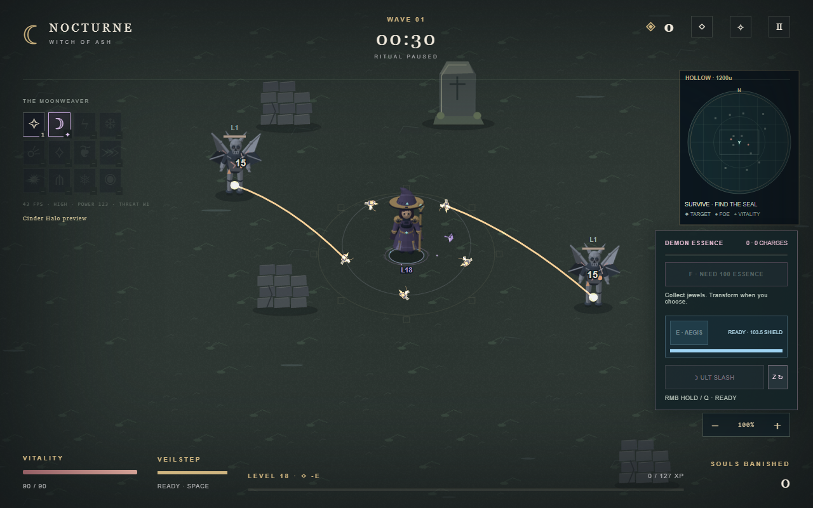

# v0.8.2 — Steady Preparation & Cinder Halo

## Stable preparation

The guardian's defeat sets camera shake to 8. Before this patch, preparation returned from `Game.update` before the combat branch that reduces shake; the remaining value therefore persisted indefinitely. The damage flash could persist through the same path.

Preparation now clears victory shake, damage flash, hit stop and impact cooldown on entry and restore. New feedback caused by a directed ritual during exploration decays on simulation time. Blocking menus still pause simulation. Ordinary combat feedback retains its existing behavior.

The real-browser regression seeds victory feedback, finishes a wave and compares repeated stationary Canvas frames byte-for-byte. A second assertion creates fresh ability feedback during preparation and verifies that it reaches zero.

## Cinder Halo at useful range

**Unlock:** learn Moon Wisps to rank IV or higher and acquire **Cinder Seed**. Cinder Halo is the evolved Moon Wisps spell; it fires automatically and needs no new key.

The nearby orbiting wisps retain their original contact damage and two-second contact ignition. The evolution now also sends warm ember lashes to enemies before they reach the orbit:

| Property | Behavior |
| --- | --- |
| Range from the player | `360 + 4 × sqrt(rank)` world units; **368 at rank IV** |
| Volley interval | `1.8 / (1 + 0.08 × (rank − 4)) × (attackInterval / 0.56)` simulation seconds |
| First volley after combat reset | 0.4 seconds, then normal cadence |
| Logical embers | `1 + floor(log2(1 + rank / 4))`: 2 at IV, 3 at XVI, continuing without a rank ceiling |
| Damage per ember | `(0.6 + 0.12 × rank) × player damage`, before existing crit/mastery/Ascension/defense rules |
| Ranged ignition | 3 seconds, with base tick damage `0.2 × player damage` per allocated ember |
| Targeting | Nearest live, active foes inside the range; deterministic ID tie-break |
| Single foe | Receives the complete logical ember budget |
| Multiple foes | The budget is shared over up to six distinct foes; higher ember counts scale damage rather than spawning more projectiles |

The ranged attack uses actual visible wisp origins and a bounded arc effect in the existing cosmetic pool. It adds no projectile or enemy population. Low quality, reduced motion and exhausted cosmetic capacity cannot remove damage. Casting seals block it without queuing a catch-up burst; preparation and Ascension trials cannot farm it. Burn damage remains attributed to Moon Wisps/Cinder Halo.

The ranged contribution is included conservatively in build assessment. Already-active guardians retain their saved maximum health and attack clocks; future encounter budgets acknowledge the improved spell. Logarithmic ember growth keeps high-rank scaling controlled while actual spell ranks remain unlimited.

## Save compatibility and validation

Container/checkpoint/world schemas and storage keys are unchanged. `spellTimers.halo` is an optional, validated field: current snapshots retain its exact value and old snapshots receive the normal initial delay. Ignition is stored through existing burn fields. Reload cannot issue an extra ranged volley or reintroduce stale preparation shake.

```bash
# From the repository root
python scripts/sync_version.py --check
python scripts/check_license.py
node JSCanvasEdition/tests/run.mjs
node JSCanvasEdition/tools/verify_foundations.cjs
node JSCanvasEdition/tools/cinder_probe.mjs
```

The added tests cover transition/restore cleanup, fresh feedback decay, pause behavior, actual midrange damage/burn, evolution gates, focused/distributed ember budgets, range/target exclusions, bounded work at high ranks, seal suppression, exact reload timing, old/malformed snapshots, quality parity and full cosmetic pools. Existing contact/ignition tests are retained.

Executed local checks: **264 existing regression groups + 64 tests passed** (12 added for this patch); **88 real Chromium Canvas/UI checks + 27 acceptance checks passed**, including HTTP, direct-file startup, five viewport sizes and no unexpected page errors. Evidence is in `validation-logs/logic-v082.txt`, `browser-v082.json` and `cinder-probe-v082.json`.

The isolated rank-IV probe measured **0 → 310.24 damage over ten seconds** against a stationary foe 240 units away, with player damage 14, no crits and no other spells. This compares the retained contact-only behavior with the new ranged attack under that fixture. It does not estimate a general DPS increase across other builds.

Version and official-license integrity checks passed. The artwork pipeline did not change; CI and the release workflow retain the full 34-test asset suite, including two complete temporary generations.

The screenshot is a paused fixture in the real Chromium renderer with two enemies beyond contact range:



The isolated probe demonstrates reach and damage attribution, not average-player win rate or long-run balance. Firefox, Safari, physical mobile hardware and audible speaker output were not tested. Runtime WebP bytes/pixels and the corrected AGPL license text are unchanged by this patch.
