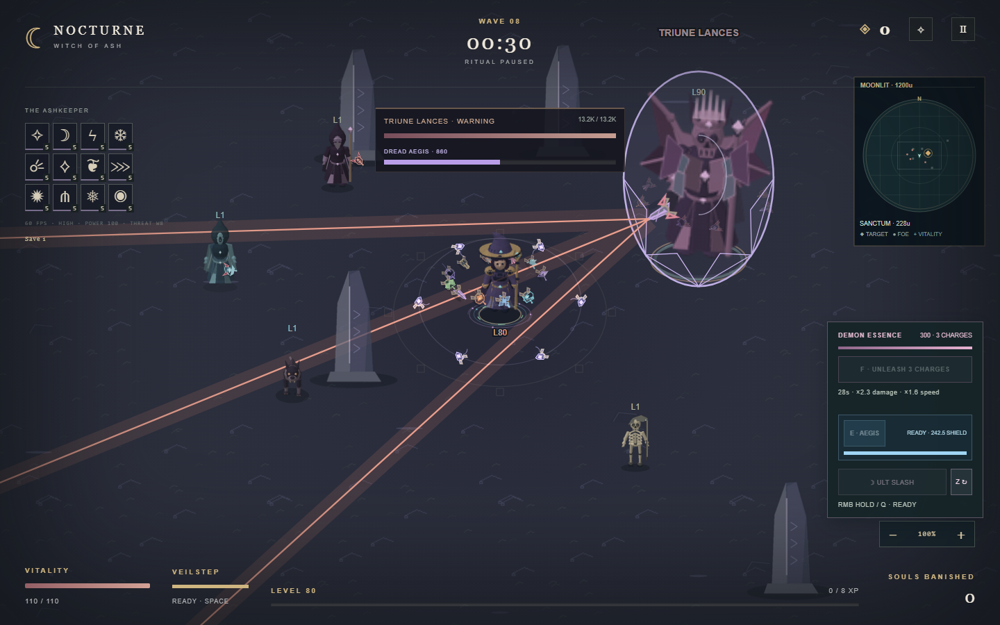
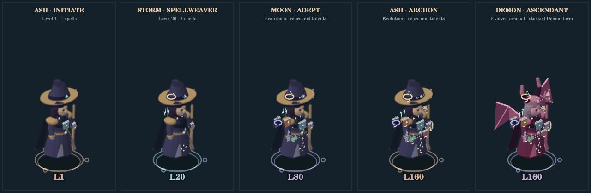
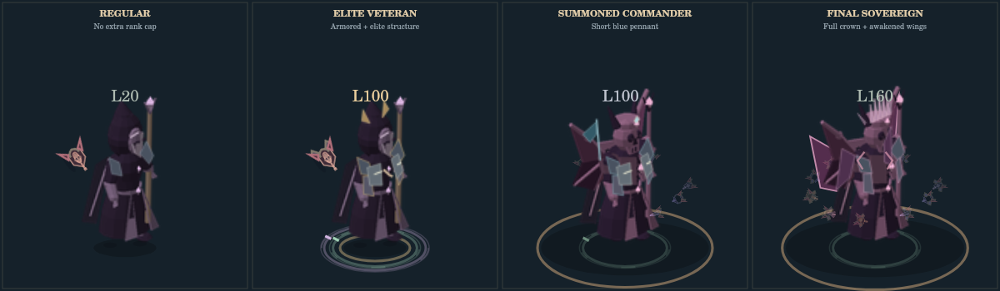
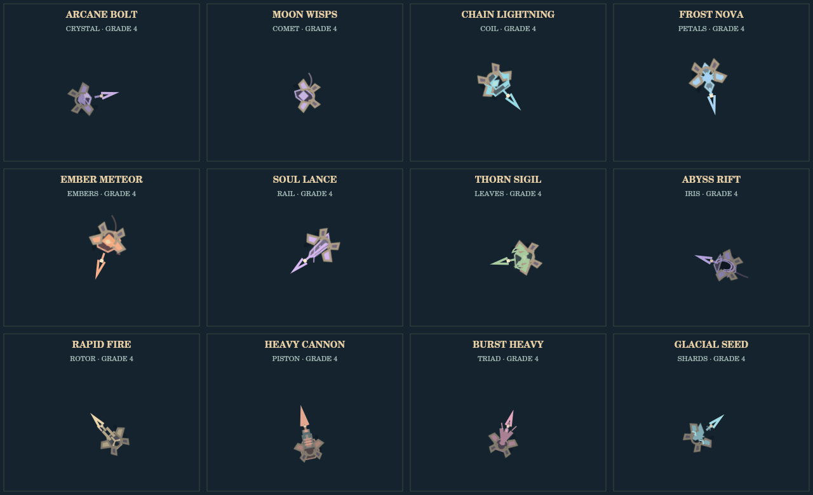

# Nocturne — Witch of Ash

**A dark-fantasy arena survival game.** Build a spell arsenal, gather Demon Essence and survive the Hollow until its Final Sovereign falls.

**Current version: <!-- version -->v0.7.6<!-- /version --> · Initial development · JSCanvasEdition**

[Download the latest release](https://github.com/Cavanshirpro/Nocturne/releases/latest) · [Play locally](#play-locally) · [Controls & game guide](JSCanvasEdition/README.md) · [Release history](JSCanvasEdition/RELEASES.md)



*A demonstration scene captured from the current game renderer: spell satellites, enemy roles, boss warnings and the HUD.*

## See the game

### Witch and Demon progression



*Actual game artwork: learned spells and progression appear on the Witch and her Demon form.* [Still image](JSCanvasEdition/previews/player-regalia.png)

### Enemies and the Final Sovereign



Nine enemy families have distinct silhouettes and eight-direction animation. Elite traits, summoned commanders and the crowned Final Sovereign have visible identities.

### Spells, fields and warnings



Twelve automatic spells grow with your build. Visible emitters show where attacks begin; field motifs and warnings help you read the fight. [Still image](JSCanvasEdition/previews/mechanisms-v525.png)

More animated models, boss rituals and before/after comparisons are included in **[the visual gallery](JSCanvasEdition/visual-gallery.html)**. Open that file locally after downloading; GitHub shows its source. The gallery has an animation pause control and respects reduced motion. Historical comparison images retain their original development labels; see the [version mapping](VERSIONING.md#historical-numbering-migration).

## Play locally

1. [Download the latest JSCanvasEdition ZIP](https://github.com/Cavanshirpro/Nocturne/releases/latest) and extract it, or clone this repository.
2. Open **`JSCanvasEdition/index.html`** in a modern browser. Keep the edition's files and `systems/` directory together.
3. Move with **WASD / arrow keys**, dash with **Space / Shift**, and build your spell arsenal through level-up choices. See the [full controls](JSCanvasEdition/README.md#controls).

No account, game engine, npm install or build step is required. Artwork is embedded, sound is synthesized locally, and the game works offline.

If the browser restricts local files, run this optional server from the repository root:

```bash
python -m http.server 8000 --directory JSCanvasEdition
```

Then visit **http://localhost:8000/**. Saves belong to the browser profile and address; export a backup from **SAVES** before moving or updating the game.

## What is playable

- **Three covens, twelve automatic spells** and directed charged rituals, with mastery and evolutions.
- **Wave survival and Final Sovereigns:** survive the swarm, find the sanctum, defeat its guardian, then visit the merchant.
- **Demon Witch and Aegis:** spend banked essence on a temporary transformation; time a defensive barrier during dangerous attacks.
- **Progression and local saves:** repeatable upgrades, talents, relics, 24 save slots and JSON backup import/export.
- **Desktop and touch controls**, adjustable zoom, low-quality rendering and reduced motion.

Nocturne is organized into editions: independent implementations of the same game concept. Features and release cycles may differ.

| Edition | Technology | Status |
| --- | --- | --- |
| [JSCanvasEdition](JSCanvasEdition/README.md) | HTML5 Canvas, JavaScript, CSS | Playable · <!-- version -->v0.7.6<!-- /version --> |
| PyGameEdition | Python, Pygame | Planned; no implementation yet |

## Development and releases

The project uses **MAJOR.MINOR.PATCH** and stays at **0.x.y** during initial development. [VERSION](VERSION) is the source of truth. The [versioning policy](VERSIONING.md) explains version increments, the historical mapping and publishing. [Release notes](JSCanvasEdition/RELEASES.md) cover individual changes and save compatibility.

See [CONTRIBUTING.md](CONTRIBUTING.md) for setup and checks. For bugs or proposals, [open an issue](https://github.com/Cavanshirpro/Nocturne/issues) with the edition, version, browser, reproduction steps and relevant screenshots or GIFs.

## License and credits

Nocturne is licensed under the **GNU Affero General Public License, version 3**. See [LICENSE](LICENSE) and the [edition's license](JSCanvasEdition/LICENSE).

- **Creator and developer:** Cavanshir Qurbanzade (YoungLion)
- **Prompter (JSCanvasEdition):** [@oustxr](https://github.com/oustxr)

Copyright (C) 2026 Cavanshir Qurbanzade.
